<div align="center">

<picture>
  <source media="(prefers-color-scheme: dark)" srcset="assets/readme/logo-dark.svg"/>
  
</picture>

**Install, manage and remove your Linux apps, easily.**

<a href="https://github.com/xuckless/easi-install/releases/latest"></a> <a href="https://github.com/xuckless/easi-install/actions/workflows/ci.yml"></a> <a href="#license"></a>

[Install](#install) · [Compare](#compare) · [CLI](#cli) · [Releases](https://github.com/xuckless/easi-install/releases/latest)

</div>

<picture>
  <source media="(prefers-color-scheme: dark)" srcset="assets/readme/hero-dark.svg"/>
  
</picture>

Downloaded an AppImage, tarball or zip? Open it with easi and drag it into Applications. easi adds the menu entry, icon and command for you.

No root needed, so it works on SteamOS, Bazzite and CachyOS too.

## Install

```sh
curl -fsSL https://raw.githubusercontent.com/xuckless/easi-install/main/scripts/install.sh | sh
```

Puts one binary in `~/.local/bin`, checks its SHA-256 (and minisign signature if you have `minisign`), and registers easi with your desktop. x86_64 and ARM64.

## Use

**Double-click** an AppImage, or **right-click** a tarball or zip → **Open With → easi**. Drag the app into Applications, or press Install.

## Keep apps up to date

Open easi to see every app you installed with it, its size and whether an update is out. Update one app or all of them.

<picture>
  <source media="(prefers-color-scheme: dark)" srcset="assets/readme/manager-dark.svg"/>
  
</picture>

Updates come from GitHub, GitLab, Codeberg, AppImage update info and more. easi finds the source for you.

## Remove cleanly, or do it all from a terminal

<picture>
  <source media="(prefers-color-scheme: dark)" srcset="assets/readme/uninstall-dark.svg"/>
  
</picture>
<picture>
  <source media="(prefers-color-scheme: dark)" srcset="assets/readme/cli-dark.svg"/>
  
</picture>

easi records every file it writes, so uninstalling removes exactly those. The CLI asks simple Y/N questions, or none with `-y`.

**Already set up apps by hand?** `easi scan` finds them and `easi adopt` brings them under easi, fixing missing icons and menu entries.<br/>
**New PC?** `easi export` on the old one, `easi import` on the new one.

## Compare

| | easi | [Gear Lever](https://github.com/mijorus/gearlever) | [AppImageLauncher](https://github.com/TheAssassin/AppImageLauncher) | [AM / AppMan](https://github.com/ivan-hc/AM) | By hand |
|---|:-:|:-:|:-:|:-:|:-:|
| AppImages | ✓ | ✓ | ✓ | ✓ | ✓ |
| Any downloaded tarball or zip | ✓ | – | – | From its catalog | ✓ |
| Menu entry and icon | ✓ | ✓ | ✓ | ✓ | You write them |
| Clean uninstall | ✓ | ✓ | ✓ | ✓ | You track the files |
| App updates | ✓ | ✓ | ✓ | ✓ | Re-download |
| GUI | ✓ | ✓ | ✓ | Third-party | – |
| CLI | ✓ | ✓ | Limited | ✓ | – |
| Needs root | Never | No | Full edition only | AM: yes, AppMan: no | Often |

<sub>Other tools as described in their own READMEs, November 2026. Spotted a mistake? Open an issue.</sub>

## Works with

**Packages:** AppImage, `.tar` (`.gz` `.xz` `.zst` `.bz2` `.lz4`), `.zip`, `.7z`, `.jar`, single Linux binaries, and `.run`/`.sh`/`.bin` installers (only after you allow it).<br/>
**Desktops:** GNOME, KDE Plasma, Cinnamon, MATE, XFCE, COSMIC, Hyprland, Sway and most others.

`.deb`, `.rpm`, Flatpak and Snap stay with your distro's own tools.

## CLI

<details>
<summary>All commands</summary>

| Command | What it does |
|---|---|
| `easi install <file>` | Install a package. `--dry-run` previews, `-y` skips questions |
| `easi inspect <file>` | Show what's inside and what would be written, without installing |
| `easi uninstall <app>` | Remove an app. `--purge-data` also removes its settings and cache |
| `easi list` | List installed apps and their sizes |
| `easi check-updates` | Check for new versions |
| `easi update <app>` / `--all` | Update one app or all of them. `--retrust` accepts a changed publisher signing key for one app |
| `easi set-source <app> [url]` | Set or auto-detect where updates come from |
| `easi scan` | Find apps you installed by hand |
| `easi adopt <app>` / `--all` | Manage those apps with easi and fix their icons and menu entries |
| `easi repair <app>` | Restore a missing icon, menu entry or command link |
| `easi organize <app>` | Move an adopted app into `~/Applications` |
| `easi forget <app>` | Stop managing an app, keep its files |
| `easi learn-wmclass <app>` | Fix duplicate dock icons |
| `easi export [file]` / `import <file>` | Reinstall your apps on another machine |
| `easi config --auto-update <bool>` | Turn easi's own update checks on or off |
| `easi self-update` | Update easi |
| `easi self-uninstall` | Remove easi, keep your apps |
| `easi --setup` / `--restore-handlers` | Register easi with your desktop, or undo it |

</details>

<details>
<summary>Where easi writes</summary>

Only inside your home folder:

- `~/Applications/<App>/`: the app
- `~/.local/share/applications/`: menu entry
- `~/.local/share/icons/hicolor/`: icon
- `~/.local/bin/`: command link
- `~/.local/share/easi/`: install records and settings

Each install is all-or-nothing: if anything fails, easi rolls back. Files that try to escape their folder are blocked and setuid bits are stripped.

</details>

<details>
<summary>Build from source</summary>

```sh
cargo build --release
```

Needs stable Rust and, on Debian/Ubuntu, `libfontconfig1-dev` and `libxkbcommon-dev`.

</details>

## License

Apache-2.0. See [LICENSE](LICENSE). README images embed [Geist](https://vercel.com/font) under the [SIL Open Font License](assets/readme/GEIST-OFL.txt).
